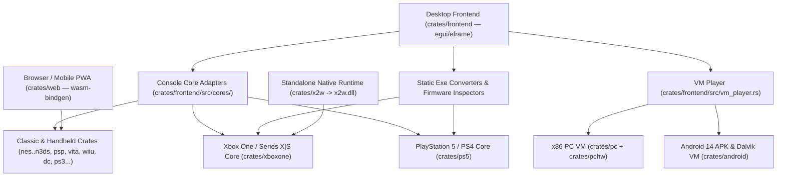

# Architecture Overview

This document explains how the desktop application, WebAssembly player, emulator cores, virtual machines, and native executable converters fit together.

---

## 1. High-Level System Diagram

---

## 2. Frontend Architecture (`crates/frontend`)

- **`app.rs`**: Main application state machine (`Home`, `Library`, `Console Mode`, `Virtual Machines`, `Settings`, `Discover`). Hosts the Home Hero Launchpad, gradient chrome, ROM folder scanning, and one-click Xbox/PS5 `.exe` conversion & firmware inspection tools.
- **`library.rs`**: Registry of every supported console (`CONSOLES`), file extensions, clean title normalization (stripping `(World)`, `(USA)`, `(Rev ...)`, `[!]`, etc.), and directory scanning for both single-file ROMs and unpacked console game folders (Xbox `MicrosoftGame.config`/`AppxManifest.xml`, PS4/PS5 `eboot.bin`/`sce_sys`).
- **`cores/`**: Wraps each hardware crate behind a uniform frame-stepping, video RGBA output, audio PCM output, input mapping, and save-state interface.
  - `cores/next_wave.rs`: Unified adapter for PSP, PS Vita, 3DS, NDS, Dreamcast, Saturn, Neo Geo, Wii, Wii U, PS3.
  - `cores/xboxone_core.rs`: Adapter bridging `crates/xboxone` into the desktop frame loop.
  - `cores/playstation.rs`: Adapter bridging `crates/ps5` into the desktop frame loop.
- **`vm.rs` & `vm_player.rs`**: Manages persistent VM presets (Windows/Linux/DOS x86 PCs + Android 14 Phone/Tablet APK runners) with PNG app icon decoding and live interactive display.

---

## 3. CPU Core Layer

Both Rust and C++ clean-room CPU cores are compiled via `cc` in crate `build.rs` scripts (using MSVC on Windows and Clang/LLVM for `wasm32-unknown-unknown`):

- **8/16-bit**: `cpu6502`, `cpu65816`, `cpusm83`, `cpuz80`, `cpu8086`, `cpu68k`
- **32-bit RISC**: `cpur3000` (PS1), `cpuarm7` (GBA), `cpuarm_v7` (NDS/3DS/Vita), `cpush` (Saturn SH-2 & Dreamcast SH-4 + FPU), `cpugekko` (GameCube/Wii/Wii U PowerPC)
- **64-bit**: `cpuvr4300` (N64), `cpur5900` (PS2 EE), `cpuxenon` (Xbox 360 & PS3 PPU), `cpui686` (PC VM), `xboxone::x64_emu` (sandboxed x86-64 for Xbox One / Series X|S)

---

## 4. WebAssembly & Cross-Platform Pipeline

- **`crates/web`** compiles selected pure-Rust and Clang-compatible C++ cores to `wasm32-unknown-unknown`, generating `web.js` + `web_bg.wasm` via `wasm-bindgen`.
- **`websites/play.html`** + **`websites/manifest.json`** provide an installable offline-capable PWA with responsive virtual touch controls for iOS Safari, Android Chrome, and console web browsers.
- **`.github/workflows/build-all-platforms.yml`** automates CI builds for Windows x64, Linux x64, macOS Apple Silicon & Intel, and Web PWA bundles.
